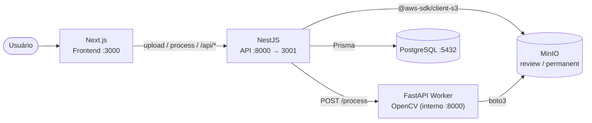

<div align="center">

  
  <h3>HawkEye</h3>
  <p><strong>Inspeção de qualidade por visão computacional</strong></p>

  []()
  []()
  []()
  []()
  []()
  []()

</div>

---

HawkEye é um sistema de **inspeção de qualidade automatizada** por visão computacional. Ele analisa imagens de componentes (pinos, eixos/hastes) e detecta defeitos sem intervenção humana: pinos ausentes, extras, danificados, com cor errada e danos estruturais, entregando métricas de qualidade por lote.

## Funcionalidades

- **Inspeção automatizada:** identifica anomalias por contraste, bordas e segmentação (OpenCV).
- **Pipeline de visão computacional em camadas:** áreas/grade, pinos, compartimentos (boxes) e hastes (shafts), cada etapa gerando uma imagem anotada.
- **Revisão humana:** preview dos resultados antes de persistir; aprovar ou rejeitar o lote.
- **Dashboard de métricas:** *quality score*, taxa de sucesso, ranking e distribuição de defeitos.
- **Gestão de lotes:** ciclo completo do upload temporário à persistência definitiva.

---

## Arquitetura

O sistema é dividido em serviços por responsabilidade, orquestrados via **Docker Compose**.



| Serviço | Stack | Porta | Função |
|:---------:|:-------:|:-------:|:--------:|
| `frontend` | Next.js 15 + React 19 + Tailwind 4 + shadcn/ui | `3000` | Interface (upload, revisão, admin) |
| `api` | NestJS 10 (TypeScript) | `8000` → `3001` | Orquestração: upload, storage, DB, métricas |
| `worker` | FastAPI (Python 3.11) + OpenCV | interno `8000` | Processamento de visão computacional |
| `db` | PostgreSQL 15 | `5432` | Lotes, capturas e compartimentos |
| `minio` | MinIO (S3-compatível) | `9000` / `9001` | Storage das imagens |

### Por que esta arquitetura?

A separação é **intencional, por responsabilidade**:

- **Next.js** entrega a interface: tipada e reativa.
- **NestJS** é a camada de **orquestração** (upload → MinIO, chamada ao worker, persistência via Prisma, agregação de métricas), com validação (`class-validator`) e injeção de dependência. Mantém a regra de negócio desacoplada da UI.
- **FastAPI (worker)** isola o **processamento de visão computacional** no ecossistema natural para isso: Python/OpenCV/NumPy. Por ser CPU-bound e não ter acesso ao banco (só ao storage), pode escalar ou falhar sem derrubar a API.

### Fluxo principal

```
Login (/)
  → funcionário: /inspecao    upload e revisão de lotes
  → admin: /admin             métricas, lotes e equipe

Upload (/inspecao)
  → POST /upload-batch        NestJS → MinIO (bucket review)
  → POST /process-images      NestJS → FastAPI /process → pipeline OpenCV → review
  → /results                  revisão humana (aprovar ou rejeitar)
  → POST /api/batches/create  NestJS → move review → permanent + grava no PostgreSQL
  → /admin                    dashboard de métricas (NestJS → PostgreSQL)
```

Rejeitar (`POST /api/batches/reject`) apaga a pasta do lote no bucket `review`. **Sem cache em memória** o storage temporário é o próprio bucket `review` do MinIO.

### Autenticação

- Login por matrícula ou e-mail e senha, com hash Argon2 e limite de tentativas.
- Sessão JWT de 8 horas em cookie `httpOnly`. A API confere o membro no banco a cada requisição, então remover uma conta ou trocar sua senha encerra as sessões abertas.
- Dois perfis com áreas separadas: `ADMIN` (`/admin`) e `EMPLOYEE` (`/inspecao`). As regras valem no middleware do Next.js e nos guards do NestJS.
- O admin define uma senha temporária, que precisa ser trocada no primeiro acesso.
- O startup cria, se ainda não existirem, as contas `admin` / `admin` e `user` / `user`. Troque essas senhas antes de expor o sistema fora do ambiente local.

Os buckets do MinIO continuam públicos: quem tiver a URL de uma imagem consegue abri-la sem login.

---

## Tecnologias

**Frontend**
- [Next.js 15](https://nextjs.org/) + [React 19](https://react.dev/) - UI tipada e reativa
- [Tailwind CSS 4](https://tailwindcss.com/) + [shadcn/ui](https://ui.shadcn.com/) - componentes
- [Recharts](https://recharts.org/) - gráficos do dashboard

**API (orquestração)**
- [NestJS 10](https://nestjs.com/) (TypeScript) - módulos, DI, DTOs validados
- [Prisma ORM](https://www.prisma.io/) - modelagem relacional (client JS)
- [@aws-sdk/client-s3](https://docs.aws.amazon.com/sdk-for-javascript/) - acesso ao MinIO

**Worker (visão computacional)**
- [FastAPI](https://fastapi.tiangolo.com/) (Python 3.11) - endpoint de processamento
- [OpenCV](https://opencv.org/) + [NumPy](https://numpy.org/) - detecção por contraste, bordas e segmentação
- [boto3](https://boto3.amazonaws.com/) - acesso ao MinIO

**Infraestrutura**
- [Docker](https://www.docker.com/) & Docker Compose
- [PostgreSQL 15](https://www.postgresql.org/)
- [MinIO](https://min.io/) - storage S3-compatível (buckets `review` e `permanent`)

---

## Como rodar

### Pré-requisitos
- [Docker](https://docs.docker.com/get-docker/) e Docker Compose

### Passos

1. **Clone o repositório:**
   ```bash
   git clone https://github.com/d3vluz/HawkEye.git
   cd HawkEye
   ```

2. **Crie e ajuste o `.env`** a partir do exemplo:
   ```bash
   cp .env.example .env
   ```
   Preencha `JWT_SECRET`. A aplicação não sobe sem esse valor.

3. **Suba o ecossistema:**
   ```bash
   docker compose up --build
   ```

4. **Acesse:**
   - Interface: [http://localhost:3000](http://localhost:3000)
   - Console do MinIO: [http://localhost:9001](http://localhost:9001) (credenciais: `MINIO_ACCESS_KEY` / `MINIO_SECRET_KEY`)
   - Health da API: [http://localhost:8000/health](http://localhost:8000/health)

---

## Estrutura

```
frontend/   Next.js 15 - interface (login, /inspecao, /results, /coletas, /admin)
api/        NestJS - orquestrador HTTP
  src/
    auth/       login, sessão e permissões por perfil
    team/       membros e unidades
    images/     upload (multer → MinIO) + proxy para o worker
    batches/    CRUD de lotes (DB + move/delete no MinIO)
    metrics/    agregação do dashboard
    storage/    cliente MinIO (@aws-sdk/client-s3)
    cv-worker/  cliente HTTP do worker
    health/     healthcheck
  prisma/schema.prisma
worker/     FastAPI - worker de visão computacional
  src/
    main.py         FastAPI + POST /process
    analise.py      roda as etapas e monta o resultado
    etapas/         grade | pinos | compartimentos | hastes
    armazenamento.py leitura e gravação no MinIO
  scripts/          executar_local.py (imagem do disco) e avaliar.py (acurácia no dataset)
docker-compose.yml
```

### Principais endpoints (API)

| Método | Rota | Perfil | Descrição |
|--------|------|--------|-----------|
| `POST` | `/api/auth/login` · `/api/auth/logout` | público | Inicia / encerra a sessão |
| `GET`  | `/api/auth/me` | autenticado | Dados da sessão |
| `POST` | `/api/auth/change-password` | autenticado | Troca a senha |
| `POST` | `/upload-batch` | funcionário | Envia imagens para o bucket `review` |
| `POST` | `/process-images` | funcionário | Dispara o pipeline no worker |
| `POST` | `/api/batches/create` | funcionário | Aprova o lote (persiste + move para `permanent`) |
| `POST` | `/api/batches/reject` | funcionário | Rejeita e apaga do `review` |
| `GET`  | `/api/batches` · `/api/batches/:id` | admin | Lista / detalha lotes, com autor |
| `GET`  | `/api/batches/mine` · `/api/batches/mine/:id` | funcionário | Coletas da própria pessoa |
| `GET`  | `/api/metrics/dashboard` | admin | Métricas do dashboard |
| `GET`  | `/api/team/overview` | admin | Métricas da equipe |
| `*`    | `/api/members` · `/api/units` | admin | Gestão de equipe |
| `GET`  | `/health` | público | Healthcheck |

### Banco de dados

```
Batch (1) → Capture (N) → Compartment (N)   [cascade delete]
```

`Capture` guarda flags de defeito (`hasMissingPins`, `hasDamagedPins`, `hasWrongColorPins`, `hasStructureDamage`, `hasShaftDefects`) e um `sha256` único por imagem para deduplicação.

## Capturas de tela

### Dashboard
> _Em desenvolvimento_

### Detalhe do lote
> _Em desenvolvimento_

### Galeria e filtros de visão computacional
> _Em desenvolvimento_

---

## Licença

Projeto desenvolvido para fins de estudo e portfólio. Licenciado sob a [MIT License](LICENSE).
