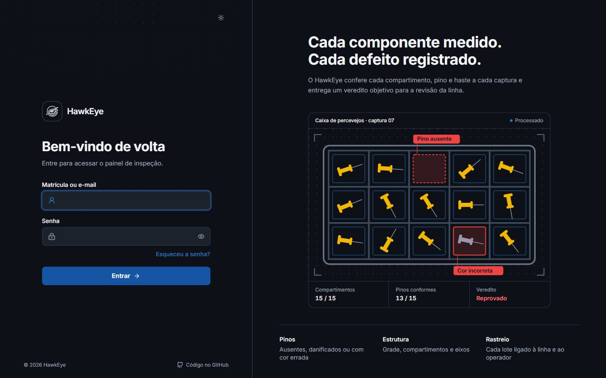
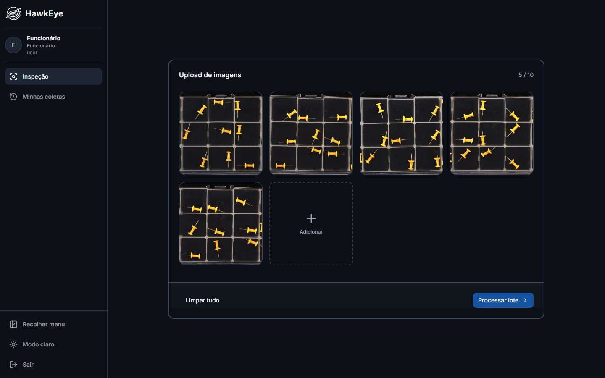
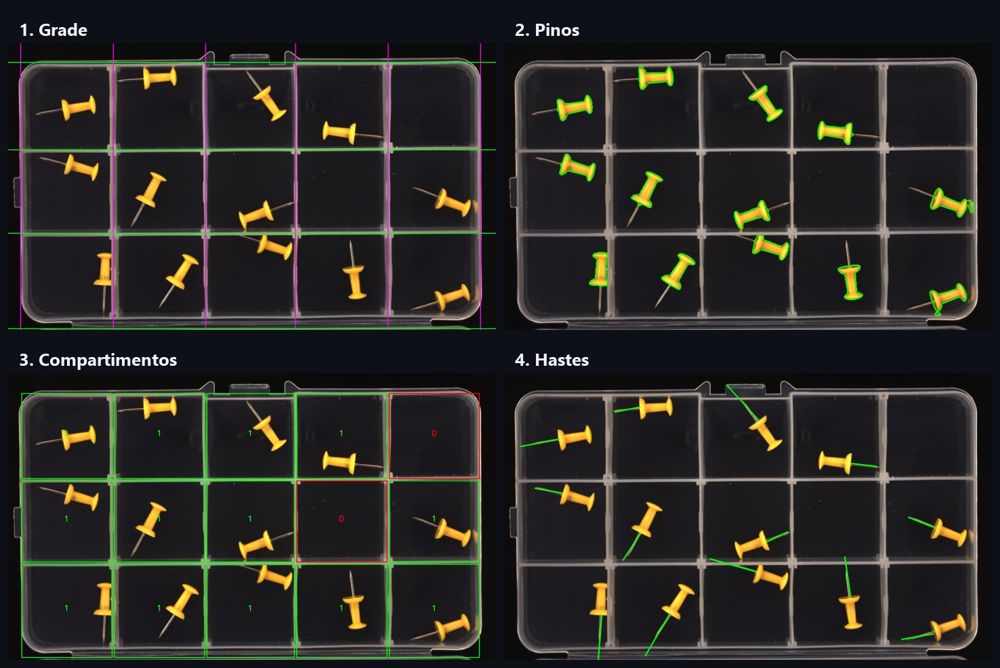
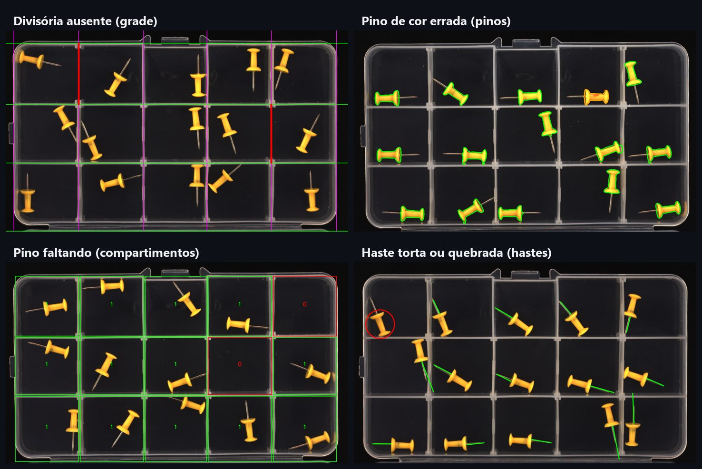
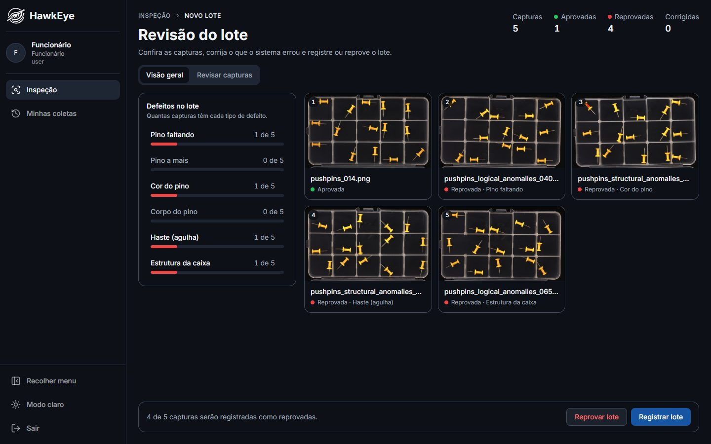
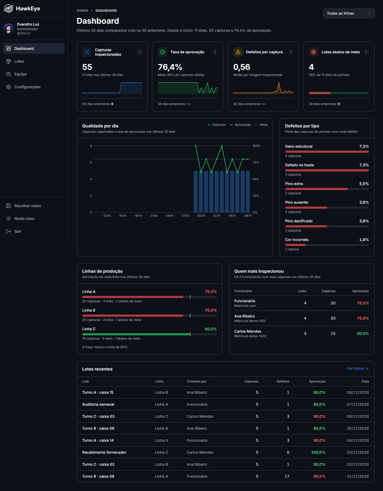
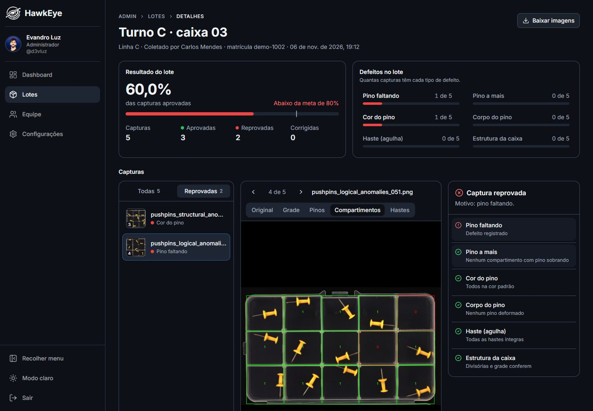
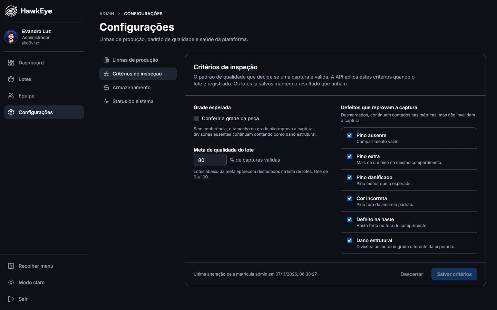

<div align="center">

  
  <h3>HawkEye</h3>
  <p><strong>Inspeção de qualidade por visão computacional</strong></p>

  [](LICENSE)
  [](docs/frontend.md)
  [](docs/api.md)
  [](docs/visao-computacional.md)

</div>

---

Numa linha de produção, alguém precisa olhar cada caixa de componentes e conferir se está tudo certo: se nenhum pino falta, se nenhum está torto, quebrado ou com a cor errada, se a própria caixa não está danificada. É um trabalho repetitivo, cansativo e fácil de errar.

O **HawkEye** faz essa conferência a partir de uma foto. O operador envia as imagens do lote, o sistema aponta o que encontrou em cada compartimento e a pessoa só confirma — ou corrige — antes de registrar. Tudo fica guardado, e a gestão acompanha a qualidade de cada linha num painel.



## Como funciona

### 1. O operador envia as fotos do lote

Na tela de inspeção, o operador arrasta as capturas da caixa (até 10 por vez) e pede a análise.



### 2. O sistema analisa cada imagem

Cada foto passa por quatro verificações: a grade da caixa, os pinos, o conteúdo de cada compartimento e as hastes (as agulhas). Cada etapa gera uma imagem marcada mostrando o que foi visto.



Quando algo está errado, a marcação aparece em vermelho:



### 3. Uma pessoa revisa antes de registrar

Nada é salvo automaticamente. O operador vê o resultado de cada captura, pode corrigir o que o sistema errou e então registra o lote ou o descarta.



### 4. A gestão acompanha a qualidade

O administrador vê a taxa de aprovação, os defeitos mais comuns, o desempenho de cada linha de produção e quem mais inspecionou.



Cada lote pode ser aberto para ver captura por captura, com todas as camadas da análise:



## O que o sistema detecta

| Defeito | O que significa |
|---------|-----------------|
| Pino faltando | Um compartimento está vazio |
| Pino a mais | Mais de um pino no mesmo compartimento |
| Cor errada | Pino fora da cor padrão |
| Pino danificado | Corpo do pino deformado ou lascado |
| Haste com defeito | Agulha quebrada, curta ou torta |
| Dano estrutural | Divisória ausente ou grade diferente da esperada |

Os critérios são configuráveis: o administrador escolhe quais defeitos reprovam uma captura e qual a meta de qualidade dos lotes.



## Resultados

Medido em um conjunto de **668 imagens reais rotuladas**, o sistema dá o veredito certo (aprovar ou reprovar) em **93,4%** dos casos. Pinos ausentes, pinos a mais, cor errada e dano estrutural são acertados em 100% das imagens desses tipos. Os detalhes estão em [Visão computacional](docs/visao-computacional.md#resultados).

## Experimente

Você só precisa do [Docker](https://docs.docker.com/get-docker/).

```bash
git clone https://github.com/d3vluz/HawkEye.git
cd HawkEye
cp .env.example .env    # preencha JWT_SECRET
docker compose up --build
```

Abra [http://localhost:3000](http://localhost:3000) e entre com `user` / `user` (operador) ou `admin` / `admin` (administrador). Troque essas senhas antes de usar fora do seu computador.

## Documentação

| Documento | Conteúdo |
|-----------|----------|
| [Arquitetura](docs/arquitetura.md) | Serviços, fluxo de uma inspeção, autenticação e decisões |
| [Banco de dados](docs/banco-de-dados.md) | Tabelas, relações e regras de integridade |
| [API](docs/api.md) | Rotas, perfis de acesso e formato das requisições |
| [Visão computacional](docs/visao-computacional.md) | Como cada etapa da análise decide e como medir a acurácia |
| [Frontend](docs/frontend.md) | Telas, organização do código e convenções |
| [Desenvolvimento](docs/desenvolvimento.md) | Como rodar, variáveis de ambiente e problemas comuns |

## Licença

Projeto desenvolvido para fins de estudo e portfólio. Licenciado sob a [MIT License](LICENSE).
