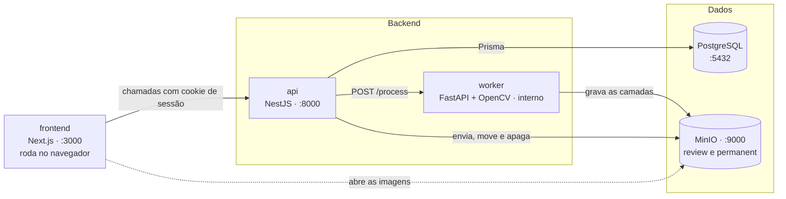
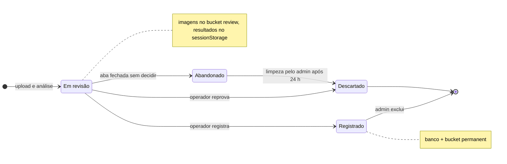
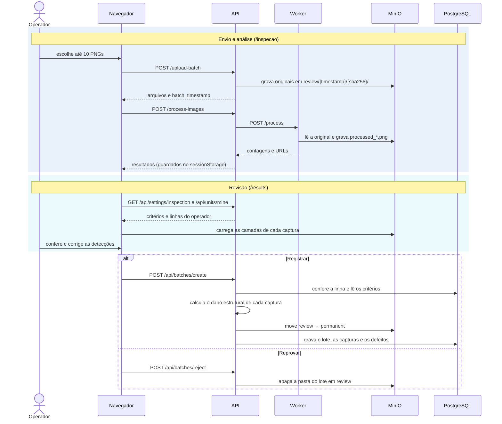
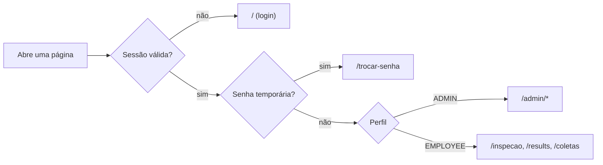

# Arquitetura

O HawkEye é dividido em serviços por responsabilidade, todos orquestrados pelo Docker Compose. A interface conversa só com a API; a API coordena o banco, o armazenamento e o worker de visão computacional.



O container do frontend só entrega as páginas. O código delas roda no navegador, que chama a API e abre as imagens direto do MinIO. O worker não tem porta exposta: só a API fala com ele, pela rede interna do Docker.

## Serviços

| Serviço | Container | Porta | Responsabilidade |
|---------|-----------|-------|------------------|
| Frontend | `hawkeye-frontend` | `3000` | Telas de login, inspeção, revisão e administração |
| API | `hawkeye-api` | `8000` → interno `3001` | Autenticação, regras de negócio, banco, armazenamento e chamada ao worker |
| Worker | `hawkeye-worker` | interno `8000` | Análise das imagens com OpenCV. Lê e grava imagens no MinIO; não acessa o PostgreSQL |
| Banco | `hawkeye-db` | `5432` | PostgreSQL 15 com lotes, capturas, equipe e critérios |
| Armazenamento | `hawkeye-minio` | `9000` / `9001` | MinIO (compatível com S3), com os buckets `review` e `permanent` |
| Inicialização | `hawkeye-minio-init` | — | Cria os buckets e libera a leitura pública; roda uma vez e termina |

A ordem de subida é garantida por `depends_on` com healthcheck: o MinIO sobe, o `minio-init` cria os buckets, o worker fica saudável e só então a API inicia. A API aplica as migrations pendentes do banco (`prisma migrate deploy`) no próprio startup.

## Por que separar assim

- **Orquestração e processamento em serviços diferentes.** A análise de imagens é pesada em CPU e vive no ecossistema natural para isso (Python, OpenCV, NumPy). Se o worker travar ou ficar lento, a API continua respondendo e só a análise falha.
- **O worker só mexe em arquivos, nunca no PostgreSQL.** Ele lê a imagem original do MinIO, grava as imagens marcadas no mesmo bucket `review` e devolve as contagens. Quem decide o veredito e grava lotes e capturas no banco é a API.
- **Sem cache em memória.** O armazenamento temporário de um lote em revisão é o próprio bucket `review`. Nada se perde se um container reiniciar.
- **Revisão humana antes de persistir.** Nenhum lote entra no banco sem que uma pessoa registre. Lote descartado não deixa rastro no PostgreSQL.

## Fluxo de uma inspeção

Um lote passa por estes estados:



Em detalhe, cada etapa chama:



Os resultados ficam no `sessionStorage` até o registro: recarregar a página não perde a revisão. Se a aba for fechada sem registrar nem reprovar, a pasta fica em `review` e passa a ser considerada abandonada após 24 horas. O admin pode limpá-la em **Configurações › Armazenamento**.

### O veredito é sempre do servidor

Na revisão, o frontend mostra o veredito usando a mesma regra da API. O veredito nunca é gravado nem aceito do navegador: a API grava os defeitos de cada captura e a versão dos critérios vigente, e calcula o veredito a cada leitura. Como versões de critérios não mudam, mudar os critérios não altera lotes já registrados. Veja [Banco de dados › Normalização](banco-de-dados.md#normalização).

## Armazenamento

| Bucket | Conteúdo | Ciclo de vida |
|--------|----------|---------------|
| `review` | Originais e imagens processadas de lotes ainda em revisão | Apagado ao descartar; movido ao registrar; limpável após 24 h |
| `permanent` | Imagens dos lotes registrados | Apagado junto com o lote |

Cada captura ocupa uma pasta `{timestamp}/{sha256}/` com os arquivos:

```
original_<nome>.png      captura enviada
processed_areas.png      grade e divisórias
processed_pins.png       contorno dos pinos
processed_boxes.png      contagem por compartimento
processed_shafts.png     hastes
```

As URLs públicas seguem o formato `MINIO_PUBLIC_URL/{bucket}/{caminho}`. Os dois buckets têm leitura anônima: quem tiver a URL de uma imagem consegue abri-la sem login. Torná-los privados exigiria URLs assinadas.

## Autenticação e perfis

- Login por matrícula ou e-mail e senha. A senha é guardada com hash Argon2 e o login aceita até 5 tentativas por minuto.
- A sessão é um JWT de 8 horas no cookie `hawkeye_session` (`httpOnly`, `SameSite=Lax`, `Secure` quando `COOKIE_SECURE=true`).
- A cada requisição, a API busca o membro no banco. Se a conta foi removida, rebaixada ou teve a senha redefinida (`tokenVersion` incrementado), a sessão aberta deixa de valer na hora.
- Todas as rotas exigem sessão por padrão. `@Publica()` libera uma rota e `@Perfis()` restringe por perfil (`api/src/autenticacao/`).
- Quem tem senha temporária (`mustChangePassword`) só consegue acessar `me`, `change-password` e `logout` até trocá-la.

| Perfil | Área no frontend | O que faz |
|--------|------------------|-----------|
| `EMPLOYEE` (funcionário) | `/inspecao`, `/results`, `/coletas` | Envia, analisa, revisa e registra lotes nas linhas a que tem acesso; vê as próprias coletas |
| `ADMIN` | `/admin/*` | Dashboard, todos os lotes, equipe, linhas de produção e configurações |

As áreas são separadas: o admin não inspeciona e o funcionário não acessa o painel. O `middleware.ts` do Next.js decide para onde cada acesso vai:



O middleware é só navegação. A permissão real é conferida pela API em cada requisição, que responde `401` sem sessão e `403` para perfil sem acesso.

O startup da API cria, se não existirem, as contas `admin` / `admin` e `user` / `user` para uso local. Novos cadastros feitos pelo admin entram como funcionário com senha temporária.

## Organização do código

```
frontend/   Next.js 15 + React 19 + Tailwind 4 + shadcn/ui
api/        NestJS 10 + Prisma
  src/
    autenticacao/   login, sessão, guardas (@Publica, @Perfis)
    equipe/         membros, linhas de produção e visão geral da equipe
    imagens/        upload para o MinIO e envio ao worker
    lotes/          registro, consulta e exclusão de lotes
    configuracoes/  critérios de inspeção, armazenamento e status dos serviços
    metricas/       dashboard
    comum/          formato único de lote e nomes dos autores
    armazenamento/  cliente MinIO (@aws-sdk/client-s3)
    worker/         cliente HTTP do worker
    banco/          BancoService (Prisma)
  prisma/schema.prisma
worker/     FastAPI + OpenCV
  src/
    main.py         POST /process e GET /health
    analise.py      roda as etapas e monta o resultado
    armazenamento.py
    etapas/         grade, pinos, compartimentos, hastes
  scripts/          executar_local.py e avaliar.py
docker-compose.yml          produção local
docker-compose.dev.yml      sobreposição para desenvolvimento com recarga automática
```

## Limitações conhecidas

- Os buckets do MinIO são públicos para leitura.
- Frontend e API precisam estar no mesmo site para o cookie de sessão funcionar (`localhost` atende).
- Não há envio de e-mail: recuperar acesso é sempre pelo admin, que define uma senha temporária.
- Pensado para rodar localmente com Docker; não há configuração de deploy em nuvem.
