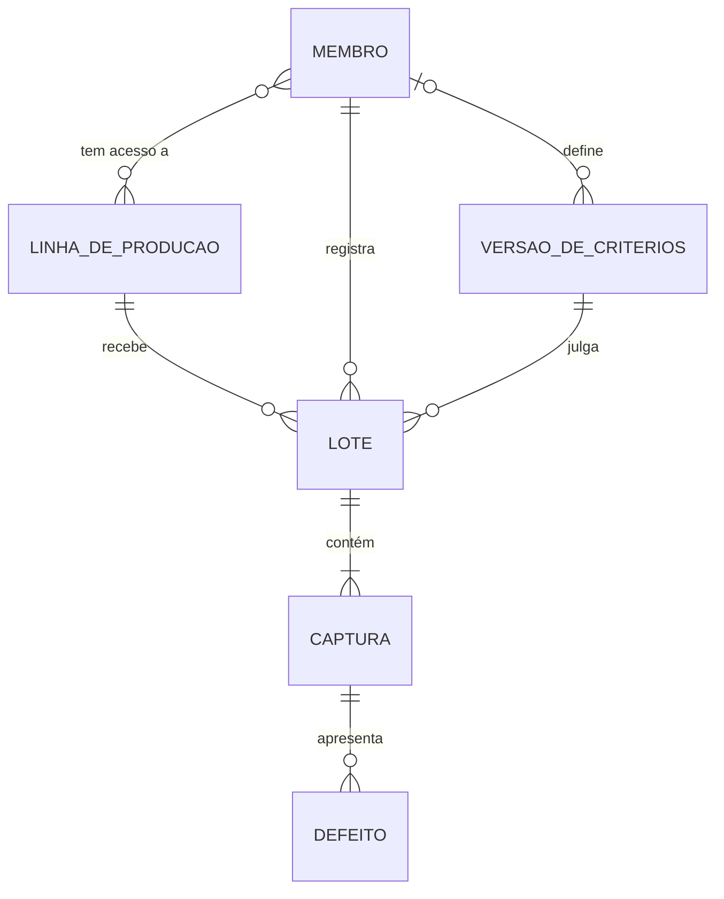
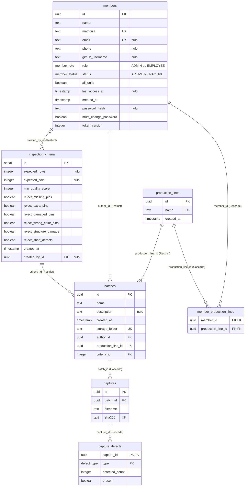

# Banco de dados

PostgreSQL 15, acessado pela API com Prisma (`prisma-client-js`). O schema fica em [`api/prisma/schema.prisma`](../api/prisma/schema.prisma) e evolui por migrations versionadas em [`api/prisma/migrations/`](../api/prisma/migrations/). O worker não acessa o PostgreSQL; ele só lê e grava imagens no MinIO.

O modelo está na **3ª forma normal**: nenhum dado que possa ser calculado a partir de outros fica gravado. Veredito das capturas, totais do lote, contagem de defeitos, correções do operador e URLs das imagens são derivados pela API a cada consulta.

## Modelo conceitual

Entidades e relacionamentos do domínio, sem detalhes de implementação.



- Um **lote** é registrado por um **membro**, numa **linha de produção**, e julgado por uma **versão dos critérios**.
- Uma **captura** é uma imagem do lote. Cada **defeito** dela guarda o que o sistema detectou e o que ficou valendo depois da revisão do operador.
- Um membro acessa todas as linhas ou só as vinculadas a ele.

## Modelo lógico

Relações com chaves primárias (sublinhadas aqui como **PK**) e estrangeiras (**FK**).

```
production_lines        (id PK, name UNIQUE, created_at)
members                 (id PK, name, matricula UNIQUE, email UNIQUE, phone, github_username, role, status,
                         all_units, last_access_at, created_at, password_hash, must_change_password, token_version)
member_production_lines (member_id PK FK → members, production_line_id PK FK → production_lines)
inspection_criteria     (id PK, expected_rows, expected_cols, min_quality_score, reject_missing_pins,
                         reject_extra_pins, reject_damaged_pins, reject_wrong_color_pins, reject_structure_damage,
                         reject_shaft_defects, created_at, created_by_id FK → members)
batches                 (id PK, name, description, created_at, storage_folder UNIQUE,
                         author_id FK → members, production_line_id FK → production_lines, criteria_id FK → inspection_criteria)
captures                (id PK, batch_id FK → batches, filename, sha256 UNIQUE)
capture_defects         (capture_id PK FK → captures, type PK, detected_count, present)
```

## Modelo físico

Tabelas como estão no PostgreSQL. "nulo" marca os campos opcionais.



No código, os models do Prisma mantêm nomes em inglês e PascalCase (`Batch`, `Capture`, `Unit`…) e são mapeados para as tabelas em `snake_case` com `@@map` e `@map`. O model `Unit` corresponde à tabela `production_lines`, e o `MemberUnit` à `member_production_lines`.

## Dicionário de dados

### `production_lines` ➝ linha de produção

| Campo | Tipo | Nulo | Padrão | Descrição |
|-------|------|------|--------|-----------|
| `id` | uuid | não | gerado | Identificador |
| `name` | text | não | — | Nome exibido; único |
| `created_at` | timestamp | não | agora | Data de cadastro |

A API cria Linha A, B e C no primeiro uso se não houver nenhuma.

---

### `members` ➝ membro da equipe

| Campo | Tipo | Nulo | Padrão | Descrição |
|-------|------|------|--------|-----------|
| `id` | uuid | não | gerado | Identificador |
| `name` | text | não | — | Nome completo |
| `matricula` | text | não | — | Identificação de login; única e imutável |
| `email` | text | sim | — | Alternativa de login; único |
| `phone` | text | sim | — | Só dígitos, com DDD |
| `github_username` | text | sim | — | Usado para o avatar |
| `role` | member_role | não | `EMPLOYEE` | `ADMIN` ou `EMPLOYEE` |
| `status` | member_status | não | `ACTIVE` | `INACTIVE` é a exclusão lógica |
| `all_units` | boolean | não | false | Acesso a todas as linhas |
| `last_access_at` | timestamp | sim | — | Último login |
| `created_at` | timestamp | não | agora | Data de cadastro |
| `password_hash` | text | sim | — | Hash Argon2; nulo bloqueia o login |
| `must_change_password` | boolean | não | true | Senha temporária a trocar no próximo acesso |
| `token_version` | integer | não | 0 | Vai no JWT; incrementar derruba as sessões abertas |

---

### `member_production_lines` ➝ acesso do membro às linhas

| Campo | Tipo | Nulo | Descrição |
|-------|------|------|-----------|
| `member_id` | uuid | não | Membro (FK, Cascade) |
| `production_line_id` | uuid | não | Linha (FK, Cascade) |

Usada só quando `all_units` é falso.

---

### `inspection_criteria` ➝ versões dos critérios

| Campo | Tipo | Nulo | Padrão | Descrição |
|-------|------|------|--------|-----------|
| `id` | serial | não | sequência | Número da versão |
| `expected_rows` / `expected_cols` | integer | sim | — | Grade esperada; os dois juntos ou nenhum |
| `min_quality_score` | integer | não | 80 | Meta de aprovação do lote, de 0 a 100 |
| `reject_*` (6 campos) | boolean | não | true | Se cada tipo de defeito reprova a captura |
| `created_at` | timestamp | não | agora | Quando a versão foi criada |
| `created_by_id` | uuid | sim | — | Admin que salvou (FK); nulo na versão inicial |

Salvar os critérios **insere** uma versão nova; a vigente é a de maior `id`. Versões nunca são alteradas.

---

### `batches` ➝ lote

| Campo | Tipo | Nulo | Padrão | Descrição |
|-------|------|------|--------|-----------|
| `id` | uuid | não | gerado | Identificador |
| `name` | text | não | — | Nome dado pelo operador |
| `description` | text | sim | — | Observações |
| `created_at` | timestamp | não | agora | Data do registro |
| `storage_folder` | text | não | — | Pasta do lote no bucket `permanent`; única |
| `author_id` | uuid | não | — | Quem registrou (FK, Restrict) |
| `production_line_id` | uuid | não | — | Linha do lote (FK, Restrict) |
| `criteria_id` | integer | não | — | Versão dos critérios usada no julgamento (FK, Restrict) |

---

### `captures` ➝ captura

| Campo | Tipo | Nulo | Descrição |
|-------|------|------|-----------|
| `id` | uuid | não | Identificador |
| `batch_id` | uuid | não | Lote (FK, Cascade) |
| `filename` | text | não | Nome do arquivo enviado |
| `sha256` | text | não | Hash da imagem; único, impede registrar a mesma imagem duas vezes |

As URLs das imagens são montadas pela API: `{MINIO_PUBLIC_URL}/permanent/{storage_folder}/{sha256}/{arquivo}`. Veja [Arquitetura › Armazenamento](arquitetura.md#armazenamento).

---

### `capture_defects` ➝ defeitos de uma captura

| Campo | Tipo | Nulo | Descrição |
|-------|------|------|-----------|
| `capture_id` | uuid | não | Captura (PK e FK, Cascade) |
| `type` | defect_type | não | `MISSING`, `EXTRA`, `WRONG_COLOR`, `DAMAGED`, `SHAFT` ou `STRUCTURE` (PK) |
| `detected_count` | integer | não | Quantas ocorrências o sistema detectou; 0 se não detectou |
| `present` | boolean | não | Se o defeito vale depois da revisão do operador |

Só existem linhas para defeitos que o sistema detectou (`detected_count > 0`) ou que o operador marcou (`present`). Ausência de linha significa "sem defeito". Houve **correção** do operador quando `detected_count > 0` difere de `present`.

## Normalização

- **1ª forma normal:** todos os atributos são atômicos e não há grupos repetitivos. Cada defeito de uma captura é uma linha de `capture_defects`, o que permite consultar e restringir os defeitos com SQL comum e incluir novos tipos sem alterar a estrutura das tabelas.
- **2ª forma normal:** as tabelas com chave composta (`member_production_lines`, `capture_defects`) não têm atributo que dependa só de parte da chave. `detected_count` e `present` dependem da captura **e** do tipo.
- **3ª forma normal:** nenhum atributo não-chave depende de outro atributo não-chave. Dados deriváveis não são gravados; a API os calcula em [`api/src/comum/lotes.ts`](../api/src/comum/lotes.ts):

| Dado | Como é obtido |
|------|---------------|
| Veredito da captura (`is_valid`) | Reprovada se tiver algum defeito `present` cujo `reject_*` esteja ligado na versão dos critérios do lote |
| Defeitos da captura (`defects`) | Tipos com `present = true` |
| Correções do operador (`corrections`) | Linhas em que `detected_count > 0` difere de `present` |
| Defeitos da captura (`defects_count`) | Soma de `max(detected_count, 1)` dos defeitos presentes |
| Totais do lote (capturas, aprovadas, reprovadas, defeitos, `quality_score`) | Agregação das capturas do lote |
| Nome do autor | Junção com `members` pela FK |
| URLs das imagens | `storage_folder` + `sha256` + nome fixo de cada arquivo |

A data de uma captura é a do lote a que ela pertence.

Como o veredito depende da versão dos critérios gravada no lote, e versões são imutáveis, o cálculo sempre dá o mesmo resultado. Uma nova versão dos critérios vale apenas para os lotes registrados depois dela.

## Regras de integridade

| Regra | Onde |
|-------|------|
| Linha com lotes não pode ser removida, só renomeada | FK `batches.production_line_id`, `ON DELETE RESTRICT` |
| Membro com lotes não pode ser apagado; a remoção é lógica (`status = INACTIVE`) | FK `batches.author_id`, `ON DELETE RESTRICT` |
| Versão de critérios usada por algum lote não pode ser apagada | FK `batches.criteria_id`, `ON DELETE RESTRICT` |
| Excluir o lote apaga capturas e defeitos | FKs com `ON DELETE CASCADE` |
| Mesma imagem não entra duas vezes; mesmo lote não é registrado duas vezes | `UNIQUE (sha256)` e `UNIQUE (storage_folder)` |
| Grade esperada com linhas e colunas juntas, positivas | `CHECK` em `inspection_criteria` |
| Meta entre 0 e 100 | `CHECK` em `inspection_criteria` |
| Linha de defeito só existe se detectado ou presente; contagem não negativa | `CHECK` em `capture_defects` |

As restrições `CHECK` estão na migration `1_normalizacao`, porque o Prisma não as expressa no schema.

## Regra do veredito

Ao registrar um lote, a API (`api/src/lotes/lotes.service.ts`):

1. Usa a versão vigente dos critérios e grava o `criteria_id` no lote.
2. Calcula o **dano estrutural** detectado: compartimentos unidos (`compartimentos < linhas × colunas`, ou seja, divisória ausente) ou grade diferente da esperada. O operador pode corrigir esse valor.
3. Grava uma linha em `capture_defects` para cada defeito detectado ou marcado, com a contagem do sistema e o valor final.

O veredito não é gravado: é calculado a cada leitura pela regra da normalização acima. O frontend (`frontend/lib/defeitos.ts`) espelha a regra só para exibir durante a revisão.

## Migrations

O container `api` roda `prisma migrate deploy` no startup, que aplica as migrations pendentes de `api/prisma/migrations/` em ordem.

| Migration | O que faz |
|-----------|-----------|
| `0_inicial` | Estrutura base do banco |
| `1_normalizacao` | Estrutura em 3ª forma normal descrita neste documento, com as restrições `CHECK` e a conversão dos dados da estrutura base |

**Mudando o schema:** edite o `schema.prisma` e gere a migration, que vai para o git:

```bash
docker compose exec api npx prisma migrate dev --name descricao_da_mudanca
```

Para mudanças que precisam converter dados, crie com `--create-only`, edite o SQL e depois aplique com `migrate dev`.

**Instalação sem histórico de migrations:** se o banco já tem a estrutura base (tabelas `"Batch"`, `"Member"`…) mas não a tabela `_prisma_migrations`, o `migrate deploy` falha com o erro P3005. Marque a migration de base como aplicada, uma única vez, e reinicie a API:

```bash
docker compose run --rm --no-deps api npx prisma migrate resolve --applied 0_inicial
```

A `1_normalizacao` então converte os dados existentes. Lotes cuja matrícula de autor não tem cadastro são ligados a um membro inativo "Membro removido" com essa matrícula, e lotes sem linha a uma linha "Sem linha".

**Apagar tudo e recomeçar:** `docker compose down -v` remove os volumes do banco e do MinIO; no próximo startup as migrations criam o banco do zero.

## Consultando o banco

```bash
docker compose exec db sh -c 'psql -U "$POSTGRES_USER" -d "$POSTGRES_DB"'
```

Os nomes estão em `snake_case`, então não precisam de aspas: `SELECT name, created_at FROM batches;`.
