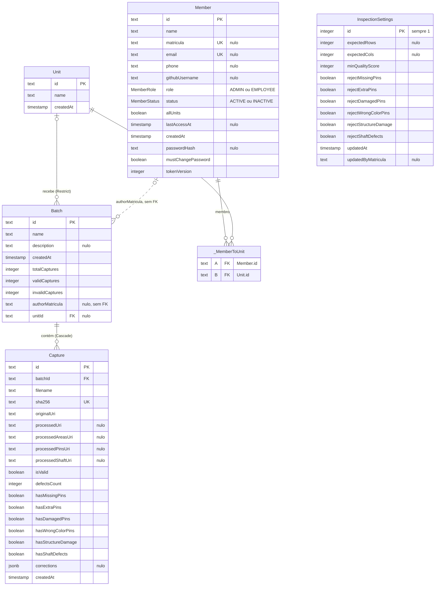

# Banco de dados

PostgreSQL 15, acessado pela API com Prisma (`prisma-client-js`). O schema fica em [`api/prisma/schema.prisma`](../api/prisma/schema.prisma). O worker não acessa o PostgreSQL; ele só lê e grava imagens no MinIO.



Tipos como ficam no PostgreSQL. "nulo" marca os campos opcionais. Os ids são `text` com UUID gerado pelo Prisma.


## Tabelas

### `Batch` ➝ lote

Um conjunto de capturas registrado de uma vez por um funcionário, numa linha de produção.

- `totalCaptures`, `validCaptures` e `invalidCaptures` são gravados no registro, para que listas e métricas não precisem contar capturas a cada consulta. A taxa de aprovação (`quality_score` na API) é `validCaptures / totalCaptures`.
- `authorMatricula` guarda a matrícula de quem registrou, **sem chave estrangeira**. O nome do autor é buscado no cadastro atual a cada consulta; se o membro for excluído, o lote mantém a matrícula e aparece sem nome.
- `unitId` liga o lote à linha com `onDelete: Restrict`: uma linha que tem lotes não pode ser removida, só renomeada, para as métricas por linha não perderem a origem.
- Índices em `(authorMatricula, createdAt)` e `(unitId, createdAt)` atendem às listas de "minhas coletas" e ao filtro por linha.

### `Capture` ➝ captura

Uma imagem analisada dentro de um lote. Excluir o lote apaga as capturas (`onDelete: Cascade`).

- `sha256` é único: a mesma imagem não pode ser registrada duas vezes.
- As cinco URIs apontam para as imagens no bucket `permanent` (veja [Arquitetura › Armazenamento](arquitetura.md#armazenamento)). `processedUri` é a imagem dos compartimentos.
- Os campos `has*` dizem quais defeitos a captura tem depois da revisão, e `isValid` é o veredito calculado pela API com os critérios vigentes no momento do registro.
- `defectsCount` soma a quantidade de cada defeito encontrado; dano estrutural conta 1.
- `corrections` registra o que o operador mudou na revisão, como uma lista de `{ defect, detected, corrected }`. É `null` quando nada foi corrigido. Permite ver, no detalhe do lote, onde o sistema errou.

### `Unit` ➝ linha de produção

Linhas de produção às quais lotes e membros se ligam. A API cria Linha A, B e C no primeiro uso se não existir nenhuma.

### `Member` ➝ membro da equipe

- `matricula` é obrigatória em cadastros novos, única e imutável. `email` é opcional e também único. O login aceita qualquer um dos dois.
- `role` é `ADMIN` ou `EMPLOYEE`; novos cadastros entram como `EMPLOYEE`.
- `status` `INACTIVE` bloqueia o login e derruba sessões abertas.
- `allUnits` dá acesso a todas as linhas; caso contrário, o acesso vem da relação muitos-para-muitos com `Unit`, guardada na tabela `_MemberToUnit` que o Prisma cria sozinho (`A` é o membro, `B` é a linha). O funcionário só registra lotes em linhas a que tem acesso.
- `passwordHash` é Argon2. `mustChangePassword` obriga a troca no próximo acesso (senha temporária definida pelo admin).
- `tokenVersion` entra no JWT da sessão. Incrementá-lo (troca ou redefinição de senha) invalida todas as sessões abertas do membro.

### `InspectionSettings` ➝ critérios de inspeção

Linha única (`id = 1`), criada com os valores padrão na primeira leitura.

- `rejectX` define se cada tipo de defeito reprova a captura. Defeitos desligados continuam contados nas métricas.
- `expectedRows` e `expectedCols` são opcionais e vêm juntos. Quando definidos, uma grade de tamanho diferente vira dano estrutural.
- `minQualityScore` é a meta de aprovação do lote (padrão 80%). Lotes abaixo dela aparecem destacados.

## Regra do veredito

A API aplica esta regra a cada captura ao registrar um lote (`api/src/configuracoes/criterios.service.ts`):

1. **Dano estrutural** é a correção do operador, se houver. Senão, é verdadeiro quando há compartimentos unidos (`compartimentos < linhas × colunas`, ou seja, divisória ausente) ou quando a grade difere da esperada.
2. A captura é **reprovada** se tiver qualquer defeito cujo critério `reject*` esteja ligado.

Os lotes já registrados guardam o veredito do momento; mudar os critérios não os recalcula.

## Como o schema é aplicado

Não há migrations versionadas. O container `api` roda `prisma db push` no startup, que sincroniza o banco com o `schema.prisma`.

- Adicionar tabela, coluna opcional ou coluna com valor padrão: basta reiniciar a API.
- Remover tabela ou coluna que já tem dados: o `db push` recusa para não perder dados. Rode uma vez dentro do container:

  ```bash
  docker compose exec api npx prisma db push --accept-data-loss
  ```

- Apagar tudo e recomeçar: `docker compose down -v` remove os volumes do banco e do MinIO.

## Consultando o banco

```bash
docker compose exec db sh -c 'psql -U "$POSTGRES_USER" -d "$POSTGRES_DB"'
```

Os nomes de tabela e coluna têm maiúsculas, então use aspas: `SELECT name, "createdAt" FROM "Batch";`.
