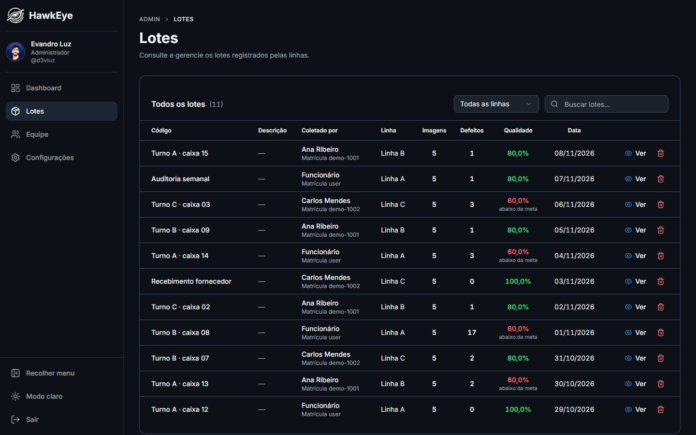
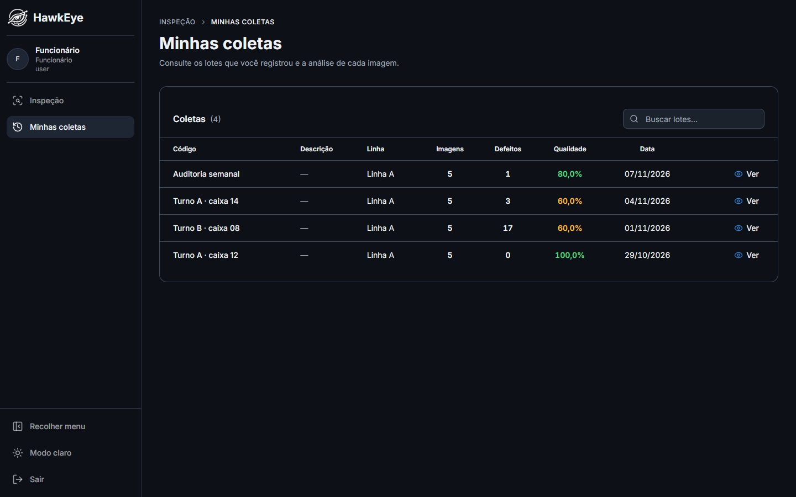

# Frontend

Interface em Next.js 15 (App Router), React 19, TypeScript, Tailwind CSS 4 e componentes shadcn/ui, com gráficos em Recharts. Roda em `http://localhost:3000` e fala apenas com a API.

## Telas

| Rota | Perfil | Tela |
|------|--------|------|
| `/` | público | Login por matrícula ou e-mail |
| `/trocar-senha` | sessão | Troca obrigatória da senha temporária |
| `/inspecao` | funcionário | Envio das imagens (PNG, até 10 por vez, 10 MB cada) e início da análise |
| `/results` | funcionário | Revisão do lote: visão geral, captura por captura, correções, registro ou descarte |
| `/coletas` · `/coletas/[id]` | funcionário | Lotes que a própria pessoa registrou |
| `/admin` | admin | Dashboard de qualidade |
| `/admin/batches` · `/admin/batches/[id]` | admin | Todos os lotes, filtro por linha, detalhe e exclusão |
| `/admin/manage_users` | admin | Equipe: cadastro, edição, linhas de acesso e redefinição de senha |
| `/admin/settings` | admin | Linhas de produção, critérios de inspeção, armazenamento e status dos serviços |

As URLs ficaram em inglês em parte por histórico; o texto das telas é todo em português (pt-BR).

| Lotes (admin) | Minhas coletas (funcionário) |
|---|---|
|  |  |

## Navegação e sessão

- [`middleware.ts`](../frontend/middleware.ts) lê o cookie `hawkeye_session` com o mesmo `JWT_SECRET` da API e redireciona: sem sessão vai para `/`, senha temporária vai para `/trocar-senha` e cada perfil fica na sua área (`/admin` ou `/inspecao`). É só navegação; quem garante a permissão é a API.
- Admin e funcionário usam o mesmo `LayoutDoApp` (`components/layout-do-app.tsx`), com menus diferentes. O menu lateral recolhe e vira só ícones em telas menores.
- A revisão guarda os resultados da análise no `sessionStorage` (`processedImages` e `reviewOverrides`) até o lote ser registrado ou descartado. Recarregar a página não perde a revisão; fechar a aba sim.

## Organização

```
frontend/
  middleware.ts       redirecionamento por sessão e perfil
  types/index.ts      todos os tipos de domínio (Lote, Captura, ResultadoDaAnalise, Membro, Criterios...)
  lib/
    api.ts            chamarApi e uma função por rota da API
    defeitos.ts       verificações, regra do veredito (espelho da API) e correções
    formato.ts        números, percentuais, datas, bytes, telefone e iniciais em pt-BR
    use-setas.ts      navegação por teclado entre capturas
    utils.ts          cn (junção de classes do Tailwind)
  components/
    acesso/           layout, ilustração animada e campos das telas de login e troca de senha
    revisao/          visualizador de camadas, lista de capturas, verificações, totais e diálogo de registro
    dashboard/        indicadores, qualidade por dia, defeitos por tipo, linhas, operadores e lotes recentes
    configuracoes/    seções da tela de configurações
    ui/               componentes shadcn/ui
    layout-do-app.tsx, cabecalho.tsx, tabela-de-lotes.tsx, detalhe-do-lote.tsx, dialogo-de-confirmacao.tsx
  app/                páginas (App Router)
    (funcionario)/    inspecao, results e coletas
    admin/            dashboard, batches, manage_users e settings
```

### Componentes compartilhados

- **`TabelaDeLotes`**: a mesma tabela com busca e cor por meta serve a lista do admin e as coletas do funcionário.
- **`DetalheDoLote`**: o detalhe de um lote registrado, usado pelo admin e pelo funcionário.
- **`revisao/`**: o visualizador de camadas, a lista de capturas e o painel de verificações servem tanto à revisão (dados do worker) quanto ao detalhe (dados do banco). As duas origens são convertidas para o mesmo `ItemDeCaptura`.
- **`Cabecalho`**: trilha de navegação (`Admin › Lotes › Detalhes`), título, descrição e ações de cada página.

## Convenções

- **Tipos num lugar só.** Todo tipo de domínio fica em `types/index.ts`. Componentes declaram apenas os tipos das próprias props.
- **Chamadas pela `lib/api.ts`.** Nenhum componente chama `fetch` direto. `chamarApi` envia o cookie, converte erros em mensagens em português e, em `401`, manda de volta ao login.
- **Uma regra de veredito.** `lib/defeitos.ts` espelha `api/src/configuracoes/criterios.service.ts` só para exibir; o veredito gravado é sempre o calculado pela API. Mudou a regra num lado, mude no outro.
- **Formatação em pt-BR.** Números, percentuais e datas passam por `lib/formato.ts` (`60,0%`, `08/11/2026`), nunca por `toFixed`.
- **Código em português.** Componentes, funções, variáveis e comentários em português; chaves de JSON e rotas da API em inglês.

## Tema e identidade visual

O modo escuro é o principal, com alternância para o claro no menu (`next-themes`). As cores seguem a paleta do projeto:

| Token | Valor | Uso |
|-------|-------|-----|
| Primary | `#2E7DD6` | Botões primários, links, foco |
| Accent | `#00B8D4` | Destaques, com moderação |
| Fundo escuro | `#0D1117` | Fundo do modo escuro |
| Success | `#22C55E` | Aprovado, dentro da meta |
| Warning | `#F59E0B` | Alertas |
| Danger | `#EF4444` | Defeitos, reprovações, erros |

Os tokens estão em [`app/globals.css`](../frontend/app/globals.css).

## Verificações

```bash
docker compose exec frontend npx tsc --noEmit
docker compose exec frontend npx next lint
```
