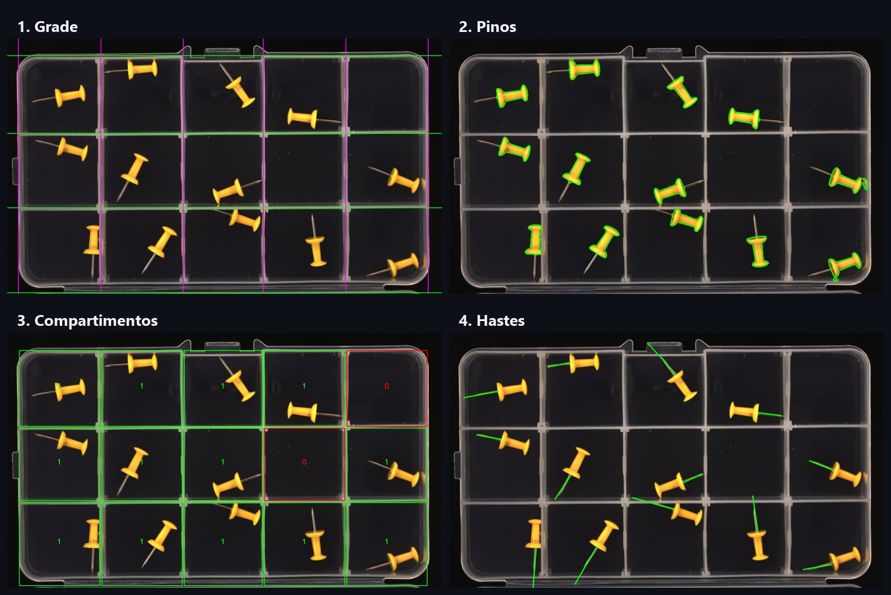
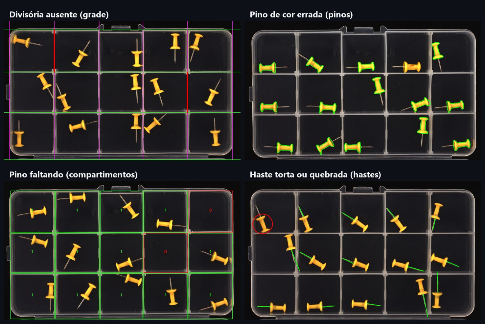

# Visão computacional

A análise das imagens roda no **worker** (`worker/`), um serviço FastAPI com OpenCV e NumPy. É um pipeline determinístico, sem aprendizado de máquina: cada etapa usa contraste, cor e geometria para decidir, e gera uma imagem marcada mostrando o que viu.

O worker não acessa o banco e só é chamado pela API, pela rede interna do Docker. Ele lê a imagem original do bucket `review`, grava as imagens processadas no mesmo bucket e devolve as contagens.



## Estrutura

```
worker/
  src/
    main.py             rotas HTTP: POST /process e GET /health
    analise.py          roda as quatro etapas e monta o resultado no formato da API
    armazenamento.py    leitura e gravação de imagens no MinIO (boto3)
    etapas/
      grade.py          divisórias da caixa e trechos de divisória ausentes
      pinos.py          pinos de qualquer cor; cor errada e corpo danificado
      compartimentos.py pinos por compartimento (vazio, certo ou com pino a mais)
      hastes.py         agulhas quebradas, curtas ou tortas
  scripts/
    executar_local.py   analisa uma imagem do disco, sem Docker nem MinIO
    avaliar.py          mede a análise contra o dataset rotulado
```

## Como cada etapa decide

### 1. Grade

A divisória da caixa é uma faixa mais clara que os dois lados a 24 px de distância. Somando essas faixas por coluna e por linha da imagem, os picos dão a posição de cada divisória e, com elas, a grade (3 × 5 na caixa padrão).

Cada trecho de divisória entre duas células é conferido à parte. Um trecho ausente une dois compartimentos, e o número de compartimentos (`areas_count`) fica menor que `linhas × colunas`. Isso vira **dano estrutural**, mesmo com a grade completa.

### 2. Pinos

Todo objeto saturado sobre o fundo escuro é candidato a pino, de qualquer cor. Reflexos na parede transparente da caixa (cerca de 10% da área de um pino) são descartados.

- **Cor errada:** mancha vermelha ou predominância de outra cor que não o amarelo padrão.
- **Pino danificado:** área ou comprimento bem abaixo da mediana dos pinos da mesma imagem. A comparação é relativa à própria foto, o que torna a decisão estável a variações de distância e iluminação.

### 3. Compartimentos

Cada pino é atribuído ao compartimento onde está. O compartimento fica **vazio** (pino faltando), **certo** (um pino) ou **com pino a mais**.

### 4. Hastes

A agulha é procurada como uma linha fina e clara saindo do disco do pino, com filtro top-hat e um leque de raios a partir do corpo. Plástico da caixa e corpos de outros pinos contam como região encoberta, não como falha.

- **Quebrada:** visível em menos de 0,35 do comprimento esperado.
- **Curta ou torta:** menos de 0,65 do comprimento esperado com o fim da agulha visível.



## Contrato com a API

`POST /process` recebe `{ "images": [{ filename, storage_path, sha256, timestamp }] }` e devolve, por imagem, as URLs das quatro imagens processadas (`areas_url`, `pins_url`, `boxes_url`, `shafts_url`) e as contagens montadas em `analise.resumo`. O formato completo está em [API › Upload e análise](api.md#upload-e-análise).

As imagens processadas são gravadas em `review/{timestamp}/{sha256}/processed_{etapa}.png`. As chaves do JSON ficam em inglês porque são compartilhadas com a API e o frontend; o código do worker é em português.

Quem transforma as contagens em defeitos e veredito é a API, com os critérios configurados pelo admin. Veja [Banco de dados › Regra do veredito](banco-de-dados.md#regra-do-veredito).

## Resultados

Medição com `scripts/avaliar.py` sobre o dataset rotulado de 668 imagens reais, em 8 classes:

| Classe | Imagens | Veredito certo | Defeito certo | Falsos alarmes mais comuns |
|--------|--------:|---------------:|--------------:|----------------------------|
| Estado OK | 508 | 94% | 94% | haste (29), pino danificado (2) |
| Ausência de pinos | 36 | 100% | 100% | — |
| Excesso de pinos | 31 | 100% | 100% | haste (13) |
| Excesso e ausência de pinos | 11 | 100% | 100% | — |
| Pinos incorretos (cor) | 22 | 100% | 100% | pino a mais (6) |
| Problemas na estrutura da caixa | 13 | 100% | 100% | — |
| Deformidade de pinos | 20 | 85% | 80% | haste (14) |
| Deformidade de hastes | 27 | 63% | 63% | — |
| **Total** | **668** | **93,4%** | | |

- **Veredito certo:** a imagem foi aprovada se é da classe OK, ou reprovada se é de uma classe com defeito.
- **Defeito certo:** além do veredito, o defeito esperado da classe foi apontado.
- **Falsos alarmes:** defeitos apontados que não pertencem à classe da imagem.

O ponto fraco atual são as **hastes**: agulhas finas e pouco contrastadas, às vezes encobertas pela caixa, geram tanto falsos alarmes em imagens boas quanto deformidades não detectadas. Como toda captura passa por revisão humana, o operador pode corrigir esses casos antes do registro, e a correção fica gravada no lote.

## Rodando fora do Docker

```bash
cd worker
pip install -r requirements.txt

# analisa uma imagem e grava as camadas e o resumo em JSON (padrão: scripts/saida/)
python scripts/executar_local.py caminho/para/imagem.png

# mede a acurácia no dataset rotulado (uma pasta por classe)
python scripts/avaliar.py caminho/para/dataset-classificado --processos 8
```

O dataset rotulado não faz parte do repositório.

## Mudando o pipeline

Depois de mudar qualquer limiar ou lógica de uma etapa, rode `avaliar.py` antes e depois da mudança e compare as duas tabelas. Uma melhora numa classe costuma custar falsos alarmes em outra, especialmente na classe OK, que é a maior.

No modo de desenvolvimento (`docker-compose.dev.yml`), o código de `worker/src/` é montado no container e o uvicorn recarrega ao salvar.

## Variáveis de ambiente

| Variável | Padrão | Uso |
|----------|--------|-----|
| `MINIO_ENDPOINT` | `http://minio:9000` | Endereço interno do MinIO |
| `MINIO_ACCESS_KEY` / `MINIO_SECRET_KEY` | — | Credenciais do MinIO |
| `MINIO_BUCKET_REVIEW` | `review` | Bucket de leitura e gravação |
| `MINIO_PUBLIC_URL` | `http://localhost:9000` | Base das URLs públicas devolvidas |
